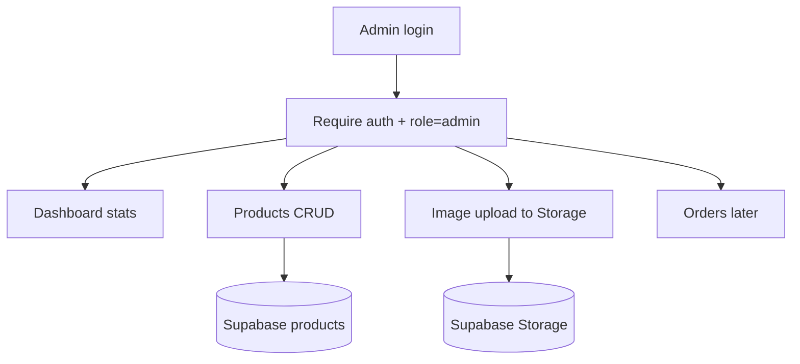

# Teeshogs Admin Section — Implementation Plan

Practical admin plan based on the current Teeshogs stack: Next.js App Router, Supabase auth/products/profiles, public product reads, and **no admin write policies or roles yet**.

## Current gaps

- Products are **read-only** in RLS (no insert/update/delete for admins)
- Profiles have no `role` / `is_admin` field
- No `orders`, `order_items`, or inventory history tables
- Checkout is still a demo (no real order records)

---

## Recommended shape

```text
/admin                  → dashboard
/admin/login            → admin-only sign-in
/admin/products         → product list
/admin/products/new     → create
/admin/products/[id]    → edit
/admin/orders           → later
/admin/customers        → later
```

Separate admin shell (sidebar + top bar), not the storefront header/footer.



---

## Phase 1 — Access control (do this first)

1. Add `role` to `profiles` (`customer` | `admin`)
2. Create a Supabase helper: `is_admin()` for RLS
3. Add product write policies: only admins can insert/update/delete
4. Protect `/admin/*` with a Next.js layout that:
   - redirects unauthenticated users to `/admin/login`
   - blocks non-admins
5. Keep storefront login separate from admin login UX (same Supabase auth is fine)

**Status:** Implemented in code. Apply the migration in Supabase, then promote your first admin.

### Apply Phase 1 migration

Run this in the Supabase SQL editor (or via CLI):

- File: `supabase/migrations/20260820104400_admin_roles_and_policies.sql`

### Promote your first admin

1. Create/sign up a user (storefront signup or Supabase Auth dashboard).
2. Run:

```sql
UPDATE profiles
SET role = 'admin'
WHERE email = 'you@example.com';
```

3. Open `/admin/login` and sign in with that account.

**Outcome:** only your admin account can change catalog data.

---

## Phase 2 — Admin shell + dashboard

1. `/admin/(dashboard)/layout.tsx` with sidebar:
   - Dashboard, Products, (Orders), (Customers), Sign out
2. Dashboard cards:
   - Total products
   - Low stock count
   - Featured / new / sale counts
   - Later: orders today, revenue

Reuse shadcn: `sidebar`, `card`, `table`, `button`, `form`, `dialog`.

**Status:** Implemented. Admin shell with responsive sidebar, live catalog stats on the dashboard, and placeholder pages for Products / Orders / Customers.

---

## Phase 3 — Products admin (core MVP)

This should be the first real build after auth.

| Feature | Details |
|---|---|
| List | Search, filter by category/status, stock badge, featured/sale toggles |
| Create / Edit | Name, slug, description, price, compare price, category, subcategory, sizes, colors, stock, flags |
| Images | Multi-image upload + reorder (matches product gallery) |
| Delete | Soft-delete later; hard delete OK for MVP with confirm dialog |
| Validation | Zod + react-hook-form |

**Slug:** auto from name, editable, unique check.

**Categories:** start with the storefront nav list (intimates, lounge, swim, accessories, etc.).

**Status:** Implemented. Products list with search/filters/flag toggles/delete, create + edit forms, and ordered image paths/URLs (file upload deferred to Phase 4).

Routes:
- `/admin/products`
- `/admin/products/new`
- `/admin/products/[id]`

---

## Phase 4 — Media / Storage

1. Supabase Storage bucket `product-images` (public read)
2. Admin-only upload policy
3. Store paths/URLs in `products.images` jsonb
4. Optional: compress/resize before upload

This replaces the temporary “extra gallery images” hardcoded on the product page.

**Status:** Implemented. Bucket migration + admin multi-file upload in the product form. Paths like `catalog/...` are stored in `products.images` and resolved to public Storage URLs; legacy `public/` filenames and absolute URLs still work. Hardcoded gallery extras removed.

### Apply Phase 4 migration

Run in the Supabase SQL editor (after Phase 1):

- File: `supabase/migrations/20260820120000_product_images_storage.sql`

---

## Phase 5 — Orders (after products work)

Only when checkout becomes real.

1. Tables: `orders`, `order_items`
2. Statuses: `pending`, `paid`, `shipped`, `delivered`, `cancelled`
3. Admin pages: list + detail + status update
4. Link customers via `profiles`

Until then, keep checkout as demo and don’t fake an orders UI.

---

## Phase 6 — Polish

- Activity log (who changed what)
- Bulk stock update
- Collections/sets as real fields (not only URL params)
- Role management (promote another admin carefully)

---

## Suggested build order

1. **DB migration**: `role` + admin RLS policies
2. **Seed one admin user** (your account)
3. **Admin layout + login guard**
4. **Products list**
5. **Create / edit product form**
6. **Image upload**
7. **Dashboard stats**
8. **Orders** (only after payment/checkout)

---

## Tech choices (fit this repo)

- **Auth:** existing Supabase client + server-side session checks in admin layout
- **UI:** existing shadcn components
- **Forms:** `react-hook-form` + `zod` (already in dependencies)
- **Data:** Supabase client for admin CRUD (admin RLS), or server actions if preferred

---

## First-version options

Pick one before coding:

1. **Products only** — fastest, unblocks catalog management
2. **Products + dashboard** — still focused, more useful day-to-day
3. **Full MVP** — products + orders + customers (needs checkout work first)
